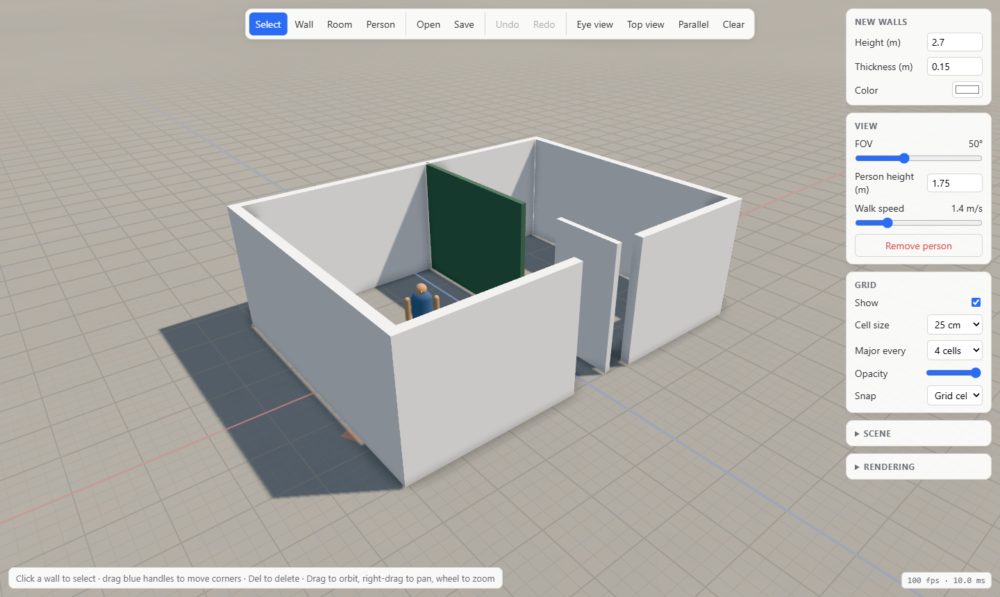

# Interior Design

A simple 3D interior design app that runs in the browser. Draw flat shapes on an infinite ground, push / pull them into 3D, look at the result from any angle, or walk through it at eye height. Built with [Three.js](https://threejs.org/).

## Features

- **Draw shapes**: line (click points; close the loop to make a face), rectangle and circle. Draw on the ground or on top of another shape. Points snap to the grid and to corners.
- **Push / Pull**: move any face of a shape to give it depth: top / bottom changes the height, a side face moves that side (a circle's side changes its radius).
- **Exact values**: type a number while drawing or pushing, then `Enter` (e.g. `2.5` for a length, `4;3` for a rectangle).
- **Edit**: select a shape to change its height, elevation or colour, or delete it. Designs made with the earlier wall tools open as shapes.
- **Eye view**: place a person and see the room through their eyes. Walk around with WASD.
- **Views**: orbit, top view and parallel (orthographic) projection.
- **Scene and rendering settings**: sky, ground, sun, fog and grid, plus optional realistic rendering (soft shadows, corner shading, sky bounce light).
- **Save and open**: a design is saved as a `.json` file that someone else can open in this app.
- **English and Turkish**: the language is picked from your browser or OS settings; switch it with the EN / TR button in the top bar (the choice is remembered).

## Running it

```sh
npm install
npm run dev
```

Then open the address it prints. A plain static server such as VS Code's Live Server also works, as long as `npm install` has been run.

## Controls

| Action | Input |
| --- | --- |
| Select / Line / Rectangle / Circle / Push-Pull / Person | `V` / `L` / `R` / `C` / `P` / `U` |
| Orbit | Drag (Select tool) or middle-drag |
| Pan | Right-drag |
| Zoom | Mouse wheel |
| Close a line into a face | Click its start point |
| Keep a line chain open | Double-click, `Enter` or right-click |
| Line at 45° steps / square rectangle | Hold `Shift` while drawing |
| Exact length / size / radius / distance | Type the value, then `Enter` |
| Push / pull a face | Drag it, or click, move, click (`Esc` cancels) |
| Delete selected shape or line | `Delete` |
| Eye view (walk with WASD, `Shift` to run, `Space` to jump) | `E` |
| Home (fit scene) / Top view / Parallel projection / Grid on-off | `H` / `T` / `O` / `G` |
| Undo / Redo | `Ctrl+Z` / `Ctrl+Y` |
| Save / Open | `Ctrl+S` / `Ctrl+O` (or drop a file onto the page) |
| Open / close all settings cards | `Ctrl`+click or middle-click a card header |


